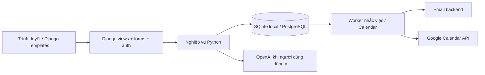

# Nhịp Học — Báo cáo kỹ thuật và đối chiếu yêu cầu

Phiên bản tài liệu: 15/11/2026. Phạm vi được người dùng chốt: hoàn thiện mã nguồn và hướng dẫn của toàn bộ kế hoạch, **chưa public website**, chưa có khóa SMTP/Google/OpenAI. Vì đề bài yêu cầu URL truy cập online, bản local này chưa phải bằng chứng đáp ứng điều kiện online khi nộp.

## 1. Bài toán và cách giải quyết

Sinh viên có nhiều môn, deadline và lịch bận. Nhịp Học lưu công việc cùng thời lượng còn lại, tìm khoảng học khả dụng và tạo phương án tuần để người dùng xem trước. Người dùng áp dụng, chỉnh giờ, khóa buổi, ghi kết quả và xem cảnh báo khi dữ liệu thay đổi. Pomodoro và nhật ký giúp theo dõi thời gian thực học; phân tích Python và AI hỗ trợ việc nhìn lại.

Ứng dụng không xem việc có lịch là đã hoàn thành. Thời gian trong nhật ký và số phút công việc còn lại là hai dữ liệu khác nhau, do người dùng ghi nhận theo kết quả thực tế.

## 2. Bảng đối chiếu từng yêu cầu

| Yêu cầu / tính năng | Giải pháp đã triển khai | Bằng chứng trong mã / cách kiểm tra |
|---|---|---|
| Web/app, phần lớn nghiệp vụ bằng Python | Django, ORM, Forms, Templates; Python xử lý quyền, lịch, thuật toán, thống kê, worker và API. JavaScript hỗ trợ đồng hồ | `config/`, các app Python; mở web local, chạy bộ test |
| Đăng ký, đăng nhập, phân quyền cơ bản | Django auth; mật khẩu băm, CSRF, kiểm tra owner; staff quản trị user qua Django Admin | [accounts](../accounts/tests.py); tài khoản B mở đối tượng của A nhận 404 |
| Tổng quan, UI/UX hoàn chỉnh | Dashboard sau đăng nhập, số liệu cá nhân, trạng thái rỗng, thanh bên Học tập trong lịch tuần, trang lỗi và CSS responsive | [dashboard](../core/dashboard.py), [test](../core/test_dashboard.py); thử desktop/375px |
| Quản lý môn học | CRUD, học kỳ, màu, lưu trữ; xóa môn giữ việc/tài liệu qua SET_NULL | [studies](../studies/models.py), [test](../studies/tests.py) |
| Quản lý công việc/deadline | Ưu tiên, ước tính, phút còn lại, chia buổi, trạng thái, tìm kiếm và lọc quá hạn | Task/Form/TaskProgress; thử hoàn thành đưa số phút về 0 |
| Tài liệu ôn tập | Lưu URL HTTP/HTTPS, mô tả, liên kết môn/công việc, CRUD và lọc | Material; không tải tệp lên hoặc đọc website bên ngoài |
| Lịch cá nhân và thời gian bận | Lịch tuần chia Sáng/Chiều/Tối, thêm/sửa/xóa dữ liệu học tập trong thanh bên; lịch bận một lần/lặp tuần/qua đêm; ngày và khung giờ học, giới hạn ngày, độ dài buổi và nghỉ | [availability](../planner/services/availability.py), [test](../planner/tests.py) |
| Tự sinh kế hoạch tuần | Thuật toán tham lam bằng Python; tìm khoảng trống, chia buổi khi được phép, tôn trọng các ràng buộc | [scheduling](../planner/services/scheduling.py), [test](../planner/test_scheduling.py) |
| Xem trước, áp dụng và chỉnh kế hoạch | Bản nháp, fingerprint đầu vào; áp dụng kiểm tra lại; chỉnh giờ, khóa, ghi nhận, hủy và xếp lại | [sessions](../planner/services/sessions.py), [test](../planner/test_replanning.py) |
| Rủi ro trễ deadline | Python tính việc quá hạn, thiếu phút trước hạn và xung đột; công khai phút chưa bố trí được | [alerts](../planner/services/alerts.py); trang Cảnh báo và báo cáo phương án |
| Pomodoro, nhật ký, thống kê | Trạng thái lưu ở máy chủ; tạm dừng/tiếp tục/lưu/hủy; khóa chống phiên trùng; nhật ký nhập tay, biểu đồ/bảng tính bằng Python | [focus](../focus/services.py), [test](../focus/tests.py) |
| Nhắc việc và email | Hàng đợi database và worker riêng; thông báo web, đã đọc/chưa đọc, tùy chọn kênh và lịch sử email; retry có giới hạn | [notifications](../notifications/tests.py); HTTP smoke đã nhận nhắc web. SMTP thật chưa thử |
| Đồng bộ lịch cá nhân | Một chiều sang lịch Google riêng; OAuth state/PKCE, mã hóa token, xem trước/xác nhận/worker, ánh xạ sự kiện và ngắt kết nối | [integrations](../integrations/tests.py); API giả lập đã thử. Google thật cần cấu hình |
| AI phân tích, phân bổ, tóm tắt, giải thích cảnh báo | Tổng hợp Python hoạt động không cần key; OpenAI Responses API có xem trước/đồng ý, schema/căn cứ, hạn mức và lịch sử. AI không tự đổi lịch | [insights](../insights/tests.py); API giả lập đã thử. API thật cần key |
| Công việc nền | Hai management command Python dùng hàng đợi database, chạy độc lập với trình duyệt | `process_reminders --watch`, `process_calendar_sync --watch`; [test kết nối](../core/test_workers.py) |
| Database và cấu hình vận hành | SQLite local; PostgreSQL qua URL; migration, WhiteNoise, Waitress, health, Docker/Compose, production HTTPS settings | [triển khai](TRIEN_KHAI.md), [.github workflow](../.github/workflows/tests.yml) |
| Kiểm thử và tài liệu bảo vệ | Unit/integration test, HTTP smoke, dữ liệu demo, checklist cộng dồn, kịch bản trình bày và báo cáo này | [HD_Test](../HD_Test.md), [nghiệm thu](NGHIEM_THU.md), [smoke](../deploy/smoke.py) |
| Deployed online, có URL truy cập | Đã chuẩn bị cấu hình; **chưa thực hiện theo yêu cầu hiện tại của người dùng** | Cần hosting, PostgreSQL bền vững, HTTPS, worker và nghiệm thu URL thật sau này |

Đề nêu nhóm công nghệ tham khảo. Dự án chọn Django thống nhất cho giao diện và backend; không cần tách FastAPI/React. Hai worker Python với hàng đợi database đáp ứng các tác vụ nền hiện có, không cần thêm Redis/Celery trong phạm vi này. Tài liệu dạng liên kết và đồng bộ một chiều là phạm vi đã thống nhất trong kế hoạch.

## 3. Kiến trúc và dữ liệu

| Nhóm dữ liệu | Quan hệ và ý nghĩa |
|---|---|
| User → Subject / Task / Material | Mỗi bản ghi có owner; liên kết môn/công việc cũng phải cùng owner |
| User → BusyEvent / StudyPreference | Nguồn ràng buộc cho quỹ thời gian tuần |
| User → StudyPlan → StudySession | Phương án, báo cáo, trạng thái áp dụng và các buổi đặt chỗ |
| User → FocusSession / StudyLog | Đồng hồ và lịch sử thực học; nhật ký giữ nhãn khi việc bị xóa |
| User → ReminderPreference / Reminder | Kênh, thời điểm, hàng đợi, trạng thái gửi và đã đọc |
| User → CalendarConnection / Mapping / Job | Kết nối hiện tại, ánh xạ sự kiện và job được xác nhận |
| User → InsightReport | Bản dữ liệu đầu vào và kết quả phân tích theo chủ sở hữu |

Database lưu timestamp có múi giờ qua Django; giao diện dùng giờ Việt Nam. Khoảng lịch tính đầu bao gồm, cuối không bao gồm để hai buổi nối tiếp không bị xem là chồng nhau. Nhật ký nhập tay theo ngày; Pomodoro quy phút vào ngày bắt đầu phiên.

## 4. Thuật toán lập lịch để giải thích khi bảo vệ

1. Chuẩn hóa ngày chọn thành thứ Hai; đọc lịch bận, khung học và buổi đã áp dụng cần giữ.
2. Dựng các khoảng trống từ thời điểm hiện tại trong tuần, có giới hạn ngày và khoảng nghỉ.
3. Xét công việc chưa xong theo deadline tăng dần, rồi ưu tiên giảm dần. Trừ phần đã có lịch tương lai được giữ để tránh xếp dư.
4. Bố trí vào khoảng hợp lệ trước deadline. Việc cho chia có thể tách thành các buổi; việc không cho chia cần khoảng liên tục đủ dài.
5. Trả danh sách buổi cùng báo cáo đã có lịch/bố trí mới/chưa bố trí và lý do. Lưu bản xem trước, chưa chiếm chỗ trên lịch.
6. Khi áp dụng, so lại đầu vào và kiểm tra ràng buộc trong transaction. Nếu dữ liệu thay đổi, yêu cầu tạo phương án mới.

Xếp lại chỉ thay phần tự động chưa bắt đầu trong tuần, giữ buổi đã bắt đầu, đã học, khóa hoặc chỉnh tay. Thuật toán là tham lam: đáp ứng kiểm tra ràng buộc nhưng **chưa chứng minh tối ưu toàn cục**. Nếu thiếu thời gian, hệ thống nêu số phút chưa bố trí, không hứa luôn tìm được một lịch đủ.

## 5. Quyền và tích hợp dịch vụ

Form không lấy owner từ dữ liệu người dùng gửi. Queryset, lựa chọn liên kết và truy cập đối tượng đều lọc theo tài khoản; Django kiểm tra đăng nhập, CSRF và mật khẩu. GET Tổng quan không ghi dữ liệu hoặc gọi API. Các bước áp dụng lịch, đánh dấu đọc, đồng bộ và yêu cầu AI dùng POST phù hợp.

Google dùng quyền tạo/quản lý lịch riêng của ứng dụng, không nhập lịch cá nhân về web. Token mã hóa bằng khóa môi trường, không xuất lên giao diện/admin. Mỗi lần đồng bộ cần xem trước/xác nhận. AI nhận số liệu và mã tham chiếu thay tên việc/môn; không nhận email, tài liệu, ghi chú hay token Google. Kết quả phải có cấu trúc và mã căn cứ hợp lệ, nhưng vẫn có thể diễn giải sai.

Email console là xem nội dung ở terminal; SMTP trả chấp nhận cũng không chứng minh thư đã vào inbox. Trường hợp kết quả SMTP không chắc chắn không tự retry để giảm nguy cơ gửi trùng. Mất phản hồi khi tạo lịch Google cũng cần kiểm tra trước khi tạo lại. Xem chi tiết cấu hình và kiểm thử dịch vụ ở mốc 08–10 trong HD_Test.md.

## 6. Bằng chứng kiểm thử và giới hạn hiện tại

| Phạm vi | Kết quả đã quan sát |
|---|---|
| Bản mã hiện tại / SQLite | **289/289 test qua**; Django check, migration dry-run, pip check và collectstatic qua |
| HTTP trên Waitress, database QA riêng | Qua đăng ký, CRUD dữ liệu chính, tạo/áp dụng/khóa lịch, thao tác focus, nhật ký/thống kê, phân quyền hai tài khoản và nhận nhắc worker |
| Trình duyệt | Tổng quan và Lịch tuần/biểu mẫu thanh bên đã kiểm tra desktop và 375px; thêm môn/việc/tài liệu và đổi deadline từ chiều sang tối hoạt động |
| PostgreSQL / CI đã xác minh trước lượt này | Commit `cfcb3b5`: 260 test SQLite và PostgreSQL 17.12 tại máy; Actions SQLite/Windows, PostgreSQL/Linux, Docker build và Compose config thành công |
| Workflow Compose mới | Đã thêm chạy web + hai worker và smoke test; **chưa xác minh trên GitHub cho bản sửa mới**, máy này chưa có Docker |
| SMTP / Google / OpenAI thật | Mã và test giả lập có sẵn; **chưa kiểm thử nhà cung cấp vì chưa có khóa** |
| Public website / HTTPS thật | **Chưa triển khai, ngoài phạm vi yêu cầu hiện tại** |

Kết quả 260 test trên PostgreSQL thuộc phiên bản trước, không thay cho kết quả chạy 289 test của mã mới trên PostgreSQL. Sau khi người dùng kiểm thử và push, cần xem hai job cùng phần Compose của commit mới trên Actions. Không dùng kết quả CI cũ để chứng minh mã chưa push.

## 7. Dàn ý trình bày và câu hỏi thường gặp

Trình bày theo [kịch bản demo](NGHIEM_THU.md): bài toán → Tổng quan/dữ liệu → ràng buộc và phương án → chỉnh/khóa/xếp lại → nhật ký/thống kê → nhắc → Google/AI → quyền và kiểm thử. Dữ liệu demo có marker `[Demo]`, không giả làm dữ liệu người dùng thật.

| Câu hỏi | Cách giải thích |
|---|---|
| AI có phải phần tự xếp lịch không? | Python tạo và kiểm tra kế hoạch. AI diễn giải dữ liệu, gợi ý phân bổ; thay đổi lịch cần người dùng xem trước và áp dụng. |
| Không có API key có dùng được không? | Toàn bộ quản lý học tập, lịch, Pomodoro, nhật ký, cảnh báo và phân tích Python dùng được; tích hợp tương ứng hiện trạng thái chưa cấu hình. |
| Vì sao đã học 25 phút nhưng việc chưa xong? | Nhật ký đo thời gian. Người dùng cập nhật phút còn cần theo kết quả thực tế; hệ thống không suy diễn năng suất từ đồng hồ. |
| Đổi deadline có tự đổi các buổi cũ không? | Không âm thầm sửa. Cảnh báo chỉ ra vấn đề; người dùng chỉnh hoặc tạo phương án xếp lại. |
| Vì sao dùng worker riêng? | Nhắc và job đồng bộ phải xử lý ngoài request, kể cả khi đóng trình duyệt; hàng đợi giữ trạng thái trong database. |
| Dữ liệu của hai người có lẫn không? | Mỗi bản ghi nghiệp vụ có owner; mọi đọc/ghi và liên kết đều kiểm tra owner, có test và hành trình hai tài khoản. |
| Dự án đã đạt yêu cầu online của đề chưa? | Chưa. Theo phạm vi hiện tại chỉ hoàn thiện source/config; cần triển khai URL thật và kiểm thử môi trường đó trước khi xác nhận yêu cầu online. |

## 8. Tài liệu bàn giao

- [README](../README.md): cài, chạy, đường dẫn chức năng và kiểm tra nhanh.
- [HD_Test](../HD_Test.md): lịch sử từng mốc, checklist hoàn thiện, hướng dẫn cấu hình/kiểm thử dịch vụ và kết quả thực tế.
- [Thiết kế](THIET_KE_BAN_DAU.md): dữ liệu, quy tắc và chi tiết nghiệp vụ.
- [Triển khai](TRIEN_KHAI.md): Waitress, worker, Compose, smoke, production và phần online còn lại.
- [Nghiệm thu](NGHIEM_THU.md): dữ liệu demo an toàn và kịch bản trình diễn.

Không có khóa thật, `.env`, database cá nhân hoặc dữ liệu QA trong mã bàn giao. Người dùng kiểm thử rồi commit/push phần source và tài liệu; website chưa được public.
